  

  
  
  
  

  

## `> ./missions --active`

| codename | what it does | built with |
|---|---|---|
| **StepzSync** | Step-race fitness app. Live group races, Wear OS sync, server-checked positions | Flutter · Firebase |
| **Unfyltered** | Social networking app with phone OTP and multi-provider sign-in | Flutter · Go |
| **ByteBox** | Cloud storage and sharing on top of Cloudflare R2 | Flutter · R2 |
| **Shubhly** | Services marketplace, live at [shubhly.in](https://shubhly.in) | Next.js · Postgres |
| **Orbit** | Personal life OS for iPhone: AlarmKit call alarms, encrypted OCR vault | SwiftUI |
| **Tether** | Control my Mac from iPhone or iPad, with a "MacBook opened" alert | SwiftUI · APNs |
| **NetBlock** | Safari content blocker | Swift |
| **DocVerify** | Document forensics: metadata, signatures, tamper signals | FastAPI · Next.js |

## `> cat arsenal.txt`

  
  
  
  
  
  
  
  
  
  
  
  

## `> tail -f contributions.log`

  

  

